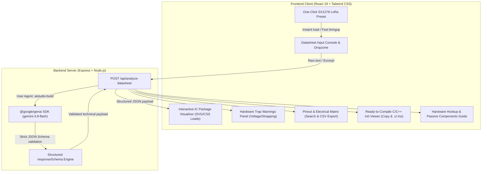

# Datasheet Pinout Co-Pilot

A high-density, dark-mode developer utility for firmware engineers, embedded hardware architects, and makers. **Datasheet Pinout Co-Pilot** transforms dense microcontroller and sensor PDF/text datasheets into structured pin matrices, critical electrical ratings, hardware trap warnings, and ready-to-compile C/C++ driver initialization code.

Powered by **Google Gemini 3.8 Flash** running securely on the Node.js server side with strict JSON schema constraints.

---

## Architecture Diagram



---

## Key Features

1. **Structured Pinout & Electrical Extraction**:
   - Parses physical pin numbers, signal names, electrical limits, directions, and multiplexed alternate functions.
   - Categorizes pin types: `POWER`, `GND`, `SPI`, `I2C`, `UART`, `GPIO`, `INTERRUPT`, `RESET`, `ANALOG`, `RF`, `CRYSTAL`, `NC`.
   - Identifies internal and external pull-up / pull-down recommendations (e.g. `10kΩ pull-up required`, `Weak internal pull-down`).

2. **Critical Hardware Trap & Warning Engine**:
   - **Voltage Limits**: Flags 3.3V vs. 5V logic incompatibilities and warns when level shifters or resistor dividers are required.
   - **Bootstrapping Conflicts**: Highlights pins that change bootloader behavior (e.g., ESP32 strapping pins or STM32 boot pins).
   - **Decoupling Rules**: Advises exact placement of 100nF and 10uF bypass capacitors adjacent to supply pins.
   - **RF / High-Frequency Hazards**: Warns against transmitting RF power without a 50Ω antenna load.
   - **Reset Pulse Timing**: Specifies microsecond/millisecond pulse lengths and PLL settling delays.

3. **Multi-Platform C/C++ Initialization Code**:
   - **STM32 HAL**: Modular `GPIO_InitTypeDef`, SPI/I2C peripheral handles, `#define` pin macros, hardware reset cycles, and version register assertions.
   - **ESP-IDF**: `gpio_config_t`, `spi_bus_config_t`, `spi_device_interface_config_t`, and FreeRTOS task notification handlers.
   - **Arduino C++**: Complete `#define` pin maps, `pinMode`, SPI/Wire transactions, and EXTI interrupt service routines.
   - **Raspberry Pi Pico (RP2040/RP2350 C/C++ SDK)**: `hardware/gpio.h`, `hardware/spi.h`, `gpio_set_function`, and rising-edge callbacks.
   - Single-click clipboard copy with animated visual feedback and direct source file downloads (`.c` / `.ino`).

4. **Interactive IC Package Visualizer**:
   - Visual dual-inline representation with color-coded signal leads (Power, Ground, SPI/Bus, Interrupt, RF).
   - Hover and click synchronization: inspecting a pin highlights its electrical limits and corresponding row in the data matrix.

5. **Instant One-Click SX1278 LoRa Transceiver Preset**:
   - Evaluators and judges can test the full capabilities instantly with genuine Semtech SX1278 datasheet technical excerpts without uploading any files.

---

## Environment Setup & API Key Configuration

The application requires a valid **GEMINI_API_KEY** for AI-driven datasheet analysis.

### `.env` Setup

Create a `.env` file in the root directory (based on `.env.example`):

```bash
# GEMINI_API_KEY: Required for Gemini AI API calls.
# AI Studio automatically injects this at runtime from user secrets.
# Users configure this via the Secrets panel in the AI Studio UI.
GEMINI_API_KEY="your-gemini-api-key-here"

# APP_URL: The URL where this applet is hosted.
APP_URL="http://localhost:3000"
```

In Google AI Studio Build, the `GEMINI_API_KEY` is automatically injected from your configured workspace secrets.

---

## Development & Production Commands

```bash
# Install dependencies
npm install

# Start development server (Express server mounting Vite on port 3000)
npm run dev

# Run TypeScript typecheck / lint
npm run lint

# Build client production bundle
npm run build

# Start production server
npm start
```

---

## Project Structure

```
├── server.ts                       # Express backend proxy with @google/genai SDK
├── index.html                      # HTML5 entry point with Plus Jakarta Sans & JetBrains Mono
├── package.json                    # Full-stack dependencies and scripts
├── .env.example                    # Environment variable template
├── src/
│   ├── App.tsx                     # Main layout & component coordinator
│   ├── main.tsx                    # React DOM client entry point
│   ├── index.css                   # Tailwind CSS v4 styling & dark theme tokens
│   ├── types/
│   │   └── datasheet.ts            # TypeScript interfaces for pins, warnings, code
│   ├── data/
│   │   └── presets.ts              # Verified presets (SX1278 LoRa, BME280)
│   └── components/
│       ├── Navbar.tsx              # 3-Zone top navigation bar
│       ├── DatasheetInput.tsx      # Text input, file dropzone, preset picker
│       ├── ChipPackageVisualizer.tsx# Interactive IC pinout package diagram
│       ├── HardwareWarningsPanel.tsx# Filterable hardware trap alerts
│       ├── PinMatrixTable.tsx      # High-density searchable pinout table
│       ├── CodeViewer.tsx          # Multi-platform C/C++ init code viewer
│       └── WiringGuidePanel.tsx    # Breadboard wiring & hookup guide
└── README.md                       # Comprehensive documentation
```
